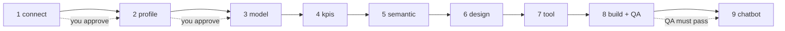

# AI Business Intelligence

**From "I have data in Snowflake" to a checked leadership dashboard and a chatbot, in nine guided steps, with your approval at every step.**

You bring data in Snowflake. Claude Code does the work: it profiles the data, proposes safe joins and KPIs, drafts
a semantic model (what your data means, in your words), designs the dashboard, builds it in Metabase, and proves
the numbers are right. You stay in control: nothing moves to the next step until you say "approve".

This is a teaching project: *this is how it is done, automated.* The code is small and readable on purpose.

---

## Contents
1. [What you get](#what-you-get)
2. [How it works](#how-it-works)
3. [Safety principles](#safety-principles)
4. [Before you start](#before-you-start)
5. [Set up](#set-up)
6. [Run the flow](#run-the-flow)
7. [Working with several tables and subjects](#working-with-several-tables-and-subjects)
8. [Bring your own KPIs and meanings (Excel)](#bring-your-own-kpis-and-meanings-excel)
9. [Command reference](#command-reference)
10. [What is in this repository](#what-is-in-this-repository)
11. [Current status and limits](#current-status-and-limits)
12. [Troubleshooting](#troubleshooting)

---

## What you get

| Output | Where it comes from |
|---|---|
| A **data profile** (columns, types, row counts, date range, null rates) | step 2 |
| A **model**: a safe view that joins your tables without breaking any count | step 3 |
| **KPIs**, each formula tested in Snowflake | step 4 |
| A **semantic model**: meanings, synonyms and a glossary, in Excel and YAML | step 5 |
| A **dashboard design** on a 24-column grid | step 6 |
| A **Metabase dashboard** with filters and an AI-written summary | step 8 |
| A **QA report**: every KPI recomputed in Snowflake and compared with Metabase | step 8 |
| A **chatbot** that answers questions in your business words | step 9 |

## How it works



Every arrow is an **approval gate**. After a step runs, Claude shows you the result and stops. It runs
`python flow.py approve <step>` only after you say so in chat, and the code refuses to run a step before the
previous one is approved. `python flow.py reset` lets you start again from any step.

| # | Step | What happens |
|---|---|---|
| 1 | **connect** | Tests the read-only Snowflake login and lists the tables |
| 2 | **profile** | One or more tables or views: columns, types, row count, date range, null rates, distinct values |
| 3 | **model** | One object: nothing to join. Several: Claude proposes a base table, many-to-one joins and rollups; row-multiplication checks run in Snowflake; a `CREATE VIEW` script is written for **you** to run |
| 4 | **kpis** | Claude suggests KPIs, or you import your own Excel list. Every formula is tested in Snowflake |
| 5 | **semantic** | Claude drafts `semantic_model.xlsx` (meanings, synonyms, glossary). You edit it; it converts to YAML |
| 6 | **design** | Claude proposes the dashboard layout. You approve or ask for changes |
| 7 | **tool** | You choose the BI tool (Metabase is ready) |
| 8 | **build** | AI summary, dashboard, filters, then QA against Snowflake |
| 9 | **chatbot** | The chatbot learns your semantic model; tested with business words. Meanings are also pushed into Metabase for its Metabot assistant |

## Safety principles

These are written into `CLAUDE.md`, which Claude follows in this project.

1. **Approval at every step.** Claude never approves for you and never skips or reorders steps.
2. **Read-only data access.** The Snowflake user is read-only. Claude never runs DDL or DML. The `CREATE VIEW` script is for *you* to run with your own rights.
3. **Credentials stay in `.env`.** They are never printed, logged, committed, or pasted into chat.
4. **QA before success.** Every KPI is recomputed with plain SQL straight from Snowflake and compared with what Metabase shows. A difference is a failure.
5. **AI-written numbers are checked.** The summary card and chatbot answers pass a number check (every number must be a rounding of a real value), and claims are spot-checked against Snowflake.
6. **Joins cannot multiply rows.** Only many-to-one joins; anything with many rows per base row is summarised first (a rollup). Checks run before any view is proposed.
7. **Invented definitions are shown to you.** Any flag or threshold Claude makes up in a derived column (for example "high priority" or a score cut-off) is listed at the gate for you to review.
8. **Honest reporting.** What was not verified, what failed and what was skipped is always stated.

## Before you start

You need:

- A **Snowflake** account with a **read-only** role and user, and a schema where views can be created.
- **Docker** (runs Metabase on your machine).
- **Python 3.9 or newer**.
- An **Anthropic API key** (for the summary card, the chatbot and the suggestions in steps 3 to 6).
- **[Claude Code](https://claude.com/claude-code)**, to run the project the guided way.

A typical read-only setup (adapt the names; an admin runs this once):

```sql
CREATE ROLE DASHBOARD_READER;
GRANT USAGE ON WAREHOUSE <WAREHOUSE> TO ROLE DASHBOARD_READER;
GRANT USAGE ON DATABASE <DATABASE> TO ROLE DASHBOARD_READER;
GRANT USAGE ON SCHEMA <DATABASE>.<SCHEMA> TO ROLE DASHBOARD_READER;
GRANT SELECT ON ALL TABLES IN SCHEMA <DATABASE>.<SCHEMA> TO ROLE DASHBOARD_READER;
GRANT SELECT ON ALL VIEWS  IN SCHEMA <DATABASE>.<SCHEMA> TO ROLE DASHBOARD_READER;
CREATE USER DASHBOARD_AGENT PASSWORD = '<choose one>' DEFAULT_ROLE = DASHBOARD_READER;
GRANT ROLE DASHBOARD_READER TO USER DASHBOARD_AGENT;
```

Views need an explicit `GRANT SELECT` to be visible to the read-only role. The `create_view.sql` script from
step 3 includes it.

## Set up

```bash
pip install -r requirements.txt
cp .env.example .env        # fill it in; never commit it
docker compose up -d        # Metabase on http://localhost:3000
```

`.env` holds your Snowflake settings, the Metabase URL and admin login, and `ANTHROPIC_API_KEY`. Check
`.env.example` for every variable.

**Metabase first run.** Metabase needs a one-time setup: an admin account, an API key (saved in `.env` as
`METABASE_API_KEY`), and your Snowflake database added and synced. `CLAUDE.md` tells Claude how to do this through
the Metabase API when you use the starter prompt. You can also do it by hand in the Metabase screens.
The flow looks for the first Snowflake database registered in Metabase.

## Run the flow

**Guided (recommended).** Open this folder in Claude Code and paste the contents of `STARTER_PROMPT.md`, with
your table or view name filled in. Claude runs one step, shows you the result and waits. Reply "approve" (or ask
for changes) and it continues.

**By hand.** Each step is one command:

```bash
python flow.py status
python flow.py connect          && python flow.py approve connect
python flow.py profile ORDERS   && python flow.py approve profile
python flow.py model suggest    # nothing to join for a single table
python flow.py approve model
python flow.py kpis suggest     && python flow.py approve kpis
python flow.py semantic draft   # edit semantic_model.xlsx, then:
python flow.py semantic convert && python flow.py approve semantic
python flow.py design           && python flow.py approve design
python flow.py tool metabase    && python flow.py approve tool
python flow.py build            && python flow.py approve build
python flow.py chatbot          && python flow.py approve chatbot
```

Read each result before you approve. That is the point of the gates.

## Working with several tables and subjects

**Several tables.** Profile them together (`python flow.py profile ORDERS CUSTOMER LINEITEM`). In step 3 Claude
proposes a base table, many-to-one joins and rollups, runs the checks, and writes `create_view.sql`. You run that
script with a role that can create views, then `python flow.py model verify`. Later steps use the view.

**Several subjects.** Each subject (for example orders, claims) is its own model, view and dashboard. Give each
its own workspace:

```bash
FLOW_WORKSPACE=orders python flow.py status
FLOW_WORKSPACE=orders python flow.py connect
```

Its approvals and files live in `workspaces/orders/`. `build_dashboard.py` follows the same variable.

**Raw tables in another database.** If the raw tables are not in the database and schema from your `.env`
(for example Snowflake's sample data), create `workspaces/<name>/source.env` containing:

```
SOURCE_DATABASE=SNOWFLAKE_SAMPLE_DATA
SOURCE_SCHEMA=TPCH_SF1
```

No secrets go in that file. Raw tables are read from there; views and dashboards always use the `.env` database
and schema, so the view must live where Metabase can see it.

## Bring your own KPIs and meanings (Excel)

- **KPIs:** `python flow.py kpis template` writes `kpis_template.xlsx`. One KPI per row: `id`, `name`,
  `definition`, `sql` (one Snowflake aggregate expression over the view's columns, no `FROM`), `format`
  (`integer`, `percent`, `minutes`, `decimal2`), and an optional target. Then `python flow.py kpis import <file>.xlsx`.
  Every formula is tested in Snowflake.
- **Semantic model:** `python flow.py semantic draft` writes `semantic_model.xlsx`. Edit meanings, add the synonyms
  your colleagues really use, fix wrong assumptions. `python flow.py semantic convert` turns it into YAML with checks.
- **Model:** `python flow.py model import <file>` loads your own `model.xlsx` (joins, derived columns, rollups).
  The same row-multiplication checks run.

## Command reference

| Command | What it does |
|---|---|
| `status` | Show each step and its gate |
| `connect` | Test the Snowflake login and list the tables |
| `profile <T1> [T2 ...]` | Profile one or more tables or views |
| `model suggest [BASE]` / `model import <file>` / `model verify` | Propose or load the model; verify the created view |
| `kpis suggest` / `kpis template` / `kpis import <file>` | Suggest, template, or load KPIs |
| `semantic draft` / `semantic convert` | Draft the semantic Excel; convert it to YAML |
| `design` | Propose the dashboard layout |
| `tool [name]` | List the BI tools, or choose one |
| `build` | AI summary, dashboard, QA against Snowflake |
| `chatbot` | Teach the chatbot the semantic model and test it |
| `reset <step\|all> [--yes]` | Start again from a step. Archives files, deletes nothing. Without `--yes` it only shows what would change |
| `approve <step>` | Record your approval of a finished step |

`build_dashboard.py` has `build`, `narrate`, `ask` (chat with the data in plain words) and `qa`.

## What is in this repository

| File | Purpose |
|---|---|
| `flow.py` | The gated nine-step flow |
| `build_dashboard.py` | Metabase builder, QA against Snowflake, AI summary, and `ask` |
| `tableau_build.py` | Generates a Tableau workbook from the approved design (see limits) |
| `CLAUDE.md` | The rules Claude follows in this project |
| `STARTER_PROMPT.md` | The prompt to paste into Claude Code to start |
| `dashboard_spec.yaml` | The worked example spec from the first version of this project |
| `examples/sales_orders/` | A finished run on Snowflake's free TPC-H sample data: what every step produces, plus the generality test results |
| `.env.example` | The settings you need in `.env` |
| `docker-compose.yml` | Runs Metabase locally |
| `requirements.txt` | Python packages |

Files the flow generates while you run it (approvals, profiles, KPIs, designs, reports, workspaces) are
git-ignored; each learner creates their own.

## Current status and limits

- **Built and QA-checked:** the nine-step flow and the Metabase dashboard, tested on three subjects (support
  tickets, insurance claims with joins, and a sales example on Snowflake's TPC-H sample data).
- **Verified through APIs, not on screen.** Look at the dashboard in your browser before you share it.
- **Snowflake only.** Other warehouses and file uploads are not supported.
- **Metabase is the ready tool.** Tableau has a workbook generator (`tableau_build.py`) that needs a template
  workbook on your published data source and a Claude session with the Tableau connector; it is not part of
  `flow.py build`. Power BI is not built.
- **Dates:** the design step uses a date or timestamp column as the time column. If the last month in your data is
  partial, month-over-month arrows will compare a partial month with a full one; the flow does not detect this yet.
- **Metabot** (Metabase's AI assistant) is configured by you in Metabase Admin settings. This project pushes your
  column meanings into Metabase for it to use; whether Metabot uses them is not verified.
- **Single table per dashboard:** each dashboard reads one table or view (the model step builds it).

## Troubleshooting

| Symptom | Fix |
|---|---|
| "No columns found" | Check the name with `python flow.py connect`. The read-only role needs `USAGE` on the schema and `SELECT` on the object |
| The view is not visible after you created it | The script's last line (`GRANT SELECT ... TO ROLE <your read-only role>`) did not run. Run the whole script, then `python flow.py model verify` |
| Metabase does not know the new view | Run `build` again; it asks Metabase to sync and waits. Or sync in Metabase Admin, Databases |
| A step refuses to run | The previous step is not approved. Check `python flow.py status` |
| `ANTHROPIC_API_KEY is empty` | Add the key to `.env` |
| A KPI formula fails | It must be ONE Snowflake aggregate expression over the view's columns, with no `FROM` clause |
| Want to start over | `python flow.py reset <step\|all> --yes`. Files are archived, not deleted |

---

*Built with Claude Code. Questions or ideas: open an issue.*
